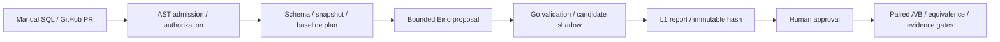

<p align="center">
  
</p>

<h1 align="center">SQL Sentinel</h1>

<p align="center"><strong>SQL recommendations backed by evidence.</strong></p>

<p align="center">SQL diagnostics and PR review, with bounded proposals, isolated shadow validation, and graded evidence.</p>

<p align="center">
  <a href="https://github.com/17hwliao/sql-sentinel/tree/master"></a>
  <a href="go.mod"></a>
  <a href="#project-license"></a>
</p>

<p align="center">
  <a href="#how-it-works">How it works</a> &nbsp;·&nbsp;
  <a href="#evidence-levels">Evidence</a> &nbsp;·&nbsp;
  <a href="#quick-start">Quick start</a> &nbsp;·&nbsp;
  <a href="#documentation">Documentation</a>
</p>

---

SQL Sentinel connects SQL admission, execution plans, candidate indexes or rewrites, shadow validation, and approval into a traceable evidence chain. Eino proposes bounded candidates; deterministic Go code validates and executes them. Reports state their evidence level, supporting facts, and unresolved assumptions.

| Bounded proposals | Isolated validation | Traceable conclusions |
| :--- | :--- | :--- |
| Model output passes structural and safety checks first. | Candidate operations run only in authorized shadow environments. | Plans, snapshots, measurements, and report hashes stay linked; insufficient evidence retains a lower grade. |

## How it works



Default analysis produces L1 plan evidence. Approved benchmark jobs record their results separately; L2 or L3 eligibility depends on the actual measurements and admission gates. There is no API for automatically applying DDL to production.

### Capabilities

| Area | Implementation and guide |
| :--- | :--- |
| **SQL and table authorization** | Bounded MySQL SELECT / WITH / UNION support, AST admission, table allowlists, and scope checks. [SQL boundaries](docs/backend-expansion.md). |
| **Durable jobs** | API → MySQL outbox → Kafka → worker / verifier, with persisted reports, lease recovery, and duplicate-event handling. [Backend baseline](docs/backend-release.md). |
| **Candidates and rewrites** | A finite evidence → draft → validate → decision graph, index proposals, explicit read-only rewrites, and result-equivalence checks. [Proposal contract](docs/backend-roadmap.md). |
| **Approval and measurement** | JWT / Casbin scopes, immutable report-hash approval, paired A/B, noise gates, and conditional L2/L3 eligibility. [Extension contract](docs/backend-expansion.md). |
| **Knowledge and history** | Persistent RAG, source-bound answers, and optional Elasticsearch historical priors. History cannot upgrade current evidence. [RAG](docs/backend-expansion.md#rag) · [History](docs/backend-roadmap.md). |
| **Integrations** | GitHub PR webhooks and optional comments, AgentMesh model access, and an mTLS verifier. [Baseline](docs/backend-release.md) · [Runtime contract](docs/backend-roadmap.md). |
| **Console and experiments** | An independent web console, plus dedicated PostgreSQL comparison and concurrent write-cost experiments. [Console](web/README.md) · [Experiment boundaries](docs/backend-roadmap.md). |

## Evidence levels

| Level | Evidence | What it supports |
| :--- | :--- | :--- |
| **L0 · Static signals** | SQL AST and deterministic rules | A risk signal that still needs plan or runtime validation. |
| **L1 · Plan evidence** | Schema, snapshots, indexes, and EXPLAIN | Plan-level diagnosis, without a proven performance improvement. |
| **L2 · Controlled benchmark** | Isolation, equivalent results, repeated A/B, and noise admission | A result limited to that benchmark dataset and protocol. |
| **L3 · Representative workload** | Qualified L2 plus source declarations and bound workload / snapshot hashes | A result that also depends on the data owner's assessment of representativeness. |

`eligible_for_performance_claim` is the report's performance-claim eligibility field. Earlier experiments returned a directional `Better` result while exceeding the noise threshold, so their conclusion remained L1/false. Those measurements are not presented as validated gains. Representative L3 results, real-model quality, and live GitHub integration still need the corresponding data and environment evidence.

## Quick start

### Try the CLI without a database

Use the Go toolchain required by [`go.mod`](go.mod). From the repository root:

```sh
# Read-only SQL admission: read a file and print JSON.
go run ./cmd/sentinel sql-admit --in examples/read-only-query.sql

# Validate CandidateSpec and preview deterministic DDL without executing it.
go run ./cmd/sentinel candidate-preview --in examples/candidate-index.json
```

Neither command connects to MySQL or calls a model. Shadow plans, A/B measurement, model proposals, and service deployment each require additional configuration.

### Preview the console

Requires Node.js 22.12 or later:

```sh
cd web
npm ci
npm run build
npm start
```

Open `http://127.0.0.1:4181/?preview=1` for a labeled sample-data preview. Real operations need backend and identity configuration; live Clerk email delivery and cross-console login still require setup. See the [console guide](web/README.md).

### Prepare a joint deployment

Clone AgentMesh and SQL Sentinel into sibling directories, then export the template from AgentMesh:

```sh
git clone https://github.com/17hwliao/AgentMesh.git
git clone https://github.com/17hwliao/sql-sentinel.git
cd AgentMesh
python scripts/export-backend-stack.py --out ../deploy
```

Follow the [export guide](https://github.com/17hwliao/AgentMesh/blob/master/deployments/backend-stack/EXPORT.md) and [operations runbook](https://github.com/17hwliao/AgentMesh/blob/master/deployments/backend-stack/ROADMAP-RUNBOOK.md) to configure private credentials, shadow data, and services. Template export does not start a database or publish GitHub comments.

## Operating boundaries

- **Use isolated shadow data.** Baseline and candidate environments must pass version and snapshot gates. Models cannot submit arbitrary DDL; production changes stay in a human-controlled process.
- **SQL support is bounded.** Cross-schema access, views, writes, locking reads, recursive CTEs, and bound parameters are outside the generic entry point. See the [admission contract](docs/backend-expansion.md).
- **Scope checks do not provide row-level isolation.** Tenant, project, and table permissions cannot separate different tenants' rows inside one shared table. Use separate shadow environments or separately assigned tables.
- **GitHub comments require explicit configuration.** `GITHUB_PUBLISH_COMMENTS` defaults to false. The production webhook and the older local simulation endpoint have separate contracts.
- **Interpret experiments within their scope.** PostgreSQL comparisons, synthetic write costs, and historical priors do not replace evidence from representative production workloads.

## Documentation

Supporting guides and historical records are currently primarily in Chinese. This English README covers the current overview and entry points.

| Start here for | Read |
| :--- | :--- |
| Services, APIs, and job recovery | [Backend baseline](docs/backend-release.md) → [Core extensions](docs/backend-expansion.md) → [Runtime extensions](docs/backend-roadmap.md) |
| Console, identity, and approval | [Web console](web/README.md) · [JWT and approval](docs/backend-expansion.md) |
| Data, counterexamples, and measurement | [Local improvements](docs/local-improvements.md) · [Original evaluation snapshot](evaluation_report.json) |
| Engineering checks and interfaces | [Engineering verification](docs/engineering-verification.md) · [OpenAPI](docs/openapi.json) |
| Deployment and rollback | [Joint deployment templates](https://github.com/17hwliao/AgentMesh/tree/master/deployments/backend-stack) · [Console deployment](https://github.com/17hwliao/AgentMesh/blob/master/deployments/backend-stack/WEB-PRODUCTION.md) |
| Specifications and earlier experiments | [Documentation index](docs/README.md) · [Specifications](specs/) · [Original README archive](docs/archive/readme-before-english.zh-CN.md) |

## Development checks

```sh
go test ./...
go vet ./...
```

See the [engineering guide](docs/engineering-verification.md) for real-dependency and end-to-end prerequisites. Listing these commands is not a claim that a new environment has been accepted.

The [archive](docs/archive/readme-before-english.zh-CN.md) preserves the original design, CLI commands, experiments, and evidence limits. Early orders-v1 restrictions, single-node graphs, proposed technologies, and "not yet implemented" descriptions refer to their checkpoint. Current behavior follows the contracts above; historical CandidateSpec examples do not replace the current strict CLI/API format.

## Project license

This repository currently has no project license file. The badge reports that status; it does not assign a license. Third-party dependency licenses are separate.
